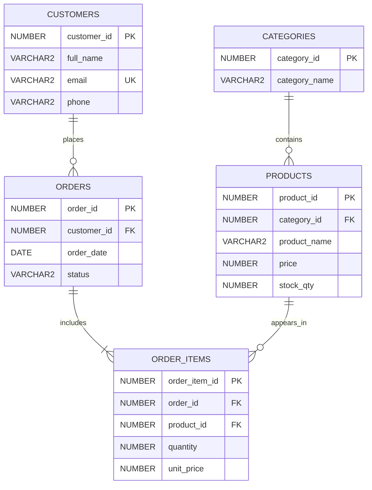

# ER Diagram — Online Shopping System

Paste this Mermaid source into https://mermaid.live to render or export the ER diagram.

## Relationships
- One category can contain many products.
- One customer can place many orders.
- One order contains one or more order items.
- One product can appear in many order items.
